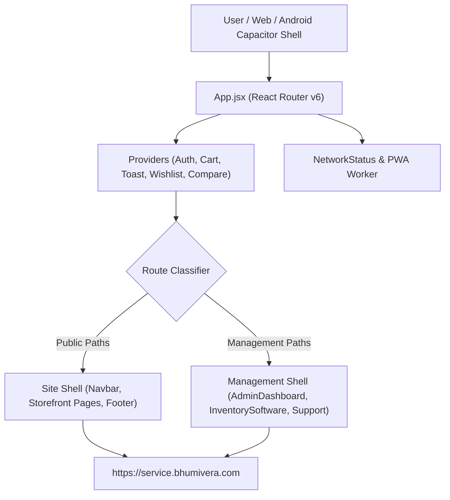

# 🗺️ Bhumivera Frontend — Architectural Blueprint & Systems Specification

> **Repository**: `Bhumivera_Frontend`  
> **Framework**: React 18.3 + Vite 6 + Tailwind CSS v4 + Framer Motion  
> **Mobile Shell**: Capacitor 8.5 (Android app)  
> **Deployment Target**: Vercel (`https://www.bhumivera.com`)  
> **Backend Endpoint**: `https://service.bhumivera.com` (Railway)  
> **Last Verified Audit**: 2026-11-03 Baseline

---

## 1. System Topology & Shell Architecture

---

## 2. The 5 Isolated Panels in Frontend

1. **`bhumivera.com` (Storefront)**:
   - 6 Flagship luxury formulations + 3 Maison regimen bundles.
   - Live batch stock badges, active milligram disclosure table, QR product verification (`/verify`), checkout (Razorpay / Wallet / COD), and live checkpoint order tracking (`/order-tracking`).
2. **`bhumivera.com/admin/login` (`/admin/dashboard`)**:
   - Marketing & Website Governance: Reward spins, referral engine, customer CRM (`/users`), product catalog, categories, reviews moderation, GST ledger.
   - **Order, delivery, shipping, and inventory tabs are strictly routed to `/inventorysoftware`**.
3. **`bhumivera.com/support` (`SupportPortal.jsx`)**:
   - L1–L3 Customer support desk: universal order/AWB/email lookup, live chat replies, courtesy coupons.
4. **`bhumivera.com/superadminsupport` (`SuperAdminSupport.jsx`)**:
   - SuperAdmin IAM vault: staff accounts, support roles, inventory software staff IDs, passkeys, TOTP 2FA.
5. **`bhumivera.com/inventorysoftware` (`InventorySoftware.jsx`)**:
   - Complete 10x omnichannel operations: `?view=online` (order lifecycle), `?view=labels` (4x6 thermal shipping labels), `?view=ret` (RTO returns), `?view=inv` (unified master stock), `?view=sale` (POS billing with dynamic UPI QR), `?view=scanner` (mobile pairing), `?view=keeper` (bin storage), `?view=grn` (GRN inwarding), `?view=audit` (physical audit), `?view=backup` (daily SQL backups).

---

## 3. Context Providers & Global State

* **`CartContext.jsx`**: User cart state, persistent local storage sync, promo code evaluation, checkout payload.
* **`AuthContext.jsx`**: Customer authentication token, user profile, login/logout, OTP verification.
* **`ToastContext.jsx`**: Maison gold & obsidian feedback toasts.
* **`WishlistContext.jsx`**: Saved botanical wishlist items.
* **`CompareContext.jsx`**: Active milligram formulation comparisons.
* **`NetworkStatus`**: Offline catalog fallback banner, PWA update prompt.
